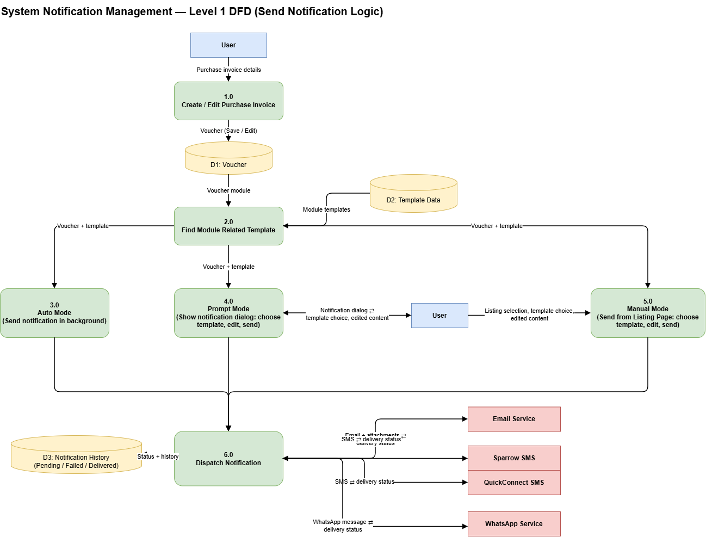

# System Notification Management: DFD (Send Notification Logic)

## Overview

This data flow diagram shows how a notification is created and sent after a Purchase Invoice is saved. The same logic applies to the other supported modules (Sales Invoice, Sales Return, Purchase Return, Credit Note, Debit Note, Cash/Bank Voucher and Journal Voucher).

## Voucher Creation

The User enters purchase invoice details in Create / Edit Purchase Invoice. The saved or edited voucher is stored in D1: Voucher.

## Finding the Template

Find Module Related Template reads the voucher module from D1 and the templates set up for that module from D2: Template Data. What happens next depends on which send modes are set up for the module in the templates found.

## Send Modes

**Auto Mode:** sends the notification in the background right after the voucher is saved, with no user action.

**Prompt Mode:** shows a notification dialog after save. The User chooses a template, edits the content and sends.

**Manual Mode:** the User starts from the Listing Page, selects a voucher, chooses a template, edits the content and sends.

### What Runs Depends on the Template Found

- **Only Auto is set up:** the system sends the notification in the background after save. No dialog is shown.
- **Auto and Prompt are both set up:** Auto runs first in the background. After the voucher is saved, the notification dialog is then shown so the User can choose a template, edit the content and send.
- **Only Manual is set up:** the system takes no action on save. The User must send the notification manually from the Listing Page.

## Dispatching the Notification

Every send, whether from Auto, Prompt or Manual, goes to Dispatch Notification. It sends the message through the selected channel and receives the delivery status back from the provider:

- Email Service: email with voucher and additional attachments
- Sparrow SMS and QuickConnect SMS: SMS message
- WhatsApp Service: WhatsApp template message

## Status and History

Dispatch Notification records the result in D3: Notification History with a status of Pending, Failed or Delivered.
