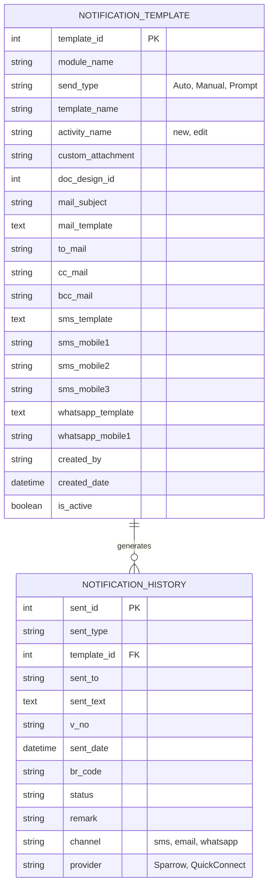

# System Notification Management — ERD & Analysis

## 1. Overview

The module manages notifications sent by the system across three channels (SMS, Email, WhatsApp). It has two entities:

- **NOTIFICATION_TEMPLATE**: configuration. Defines *what* is sent, *when/how* it is triggered, and *to whom*.
- **NOTIFICATION_HISTORY**: log. Records every notification actually sent, with its status.

Relationship: one template → many history records (`NOTIFICATION_HISTORY.template_id` → `NOTIFICATION_TEMPLATE.template_id`).

---

## 2. ERD

---

## 3. Entity Dictionary

### 3.1 NOTIFICATION_TEMPLATE

| Column | Description / Purpose |
|---|---|
| `template_id` (PK) | Unique template identifier |
| `module_name` | System module that triggers the notification |
| `send_type` | `Auto` (fired by system event), `Manual` (user-initiated), `Prompt` (system asks user to confirm) |
| `template_name` | Human-readable template name |
| `activity_name` | Event that triggers it: `new` or `edit` |
| `custom_attachment` | Custom attachment configuration |
| `doc_design_id` | Reference to the document/print design used as the attachment |
| `mail_subject` / `mail_template` | Email subject and body (with placeholders) |
| `to_mail` / `cc_mail` / `bcc_mail` | Email recipients |
| `sms_template` | SMS body |
| `sms_mobile1..3` | Up to three fixed SMS recipients |
| `whatsapp_template` | WhatsApp message body |
| `whatsapp_mobile1` | Fixed WhatsApp recipient |
| `created_by` / `created_date` | Audit fields |
| `is_active` | Enable/disable the template |

### 3.2 NOTIFICATION_HISTORY

| Column | Description / Purpose |
|---|---|
| `sent_id` (PK) | Unique log identifier |
| `sent_type` | How it was sent (Auto / Manual / Prompt) |
| `template_id` (FK) | Template used |
| `sent_to` | Actual recipient (email address or mobile number) |
| `sent_text` | Final rendered message content |
| `v_no` | Voucher / document number that triggered the notification |
| `sent_date` | Timestamp of sending |
| `br_code` | Branch code |
| `status` | Delivery status |
| `remark` | Error message or extra notes |
| `channel` | `sms`, `email`, `whatsapp` |
| `provider` | Gateway used: `Sparrow`, `QuickConnect` |

---

## 4. Functional Flow

1. A business event occurs in a module (e.g. a new voucher is saved).
2. The system looks up active templates where `module_name` + `activity_name` match.
3. Based on `send_type`:
   - **Auto**: send immediately.
   - **Prompt**: ask the user whether to send.
   - **Manual**: wait for the user to trigger it.
4. Placeholders in the templates are replaced with real data.
5. An attachment is generated if `doc_design_id` / `custom_attachment` is set.
6. For each channel with content, the message is sent through the configured provider (Sparrow / QuickConnect).
7. A row is written to `NOTIFICATION_HISTORY` per recipient per channel, with `status` and `remark`.

---

## 5. Business Rules

- A template must be active (`is_active = true`) to be used.
- Email uses `to_mail`, `cc_mail`, `bcc_mail`; SMS uses `sms_mobile1..3`; WhatsApp uses `whatsapp_mobile1`.
- Each send creates one history row per recipient per channel.
- History stores the rendered `sent_text`, so later template changes do not alter past records.
